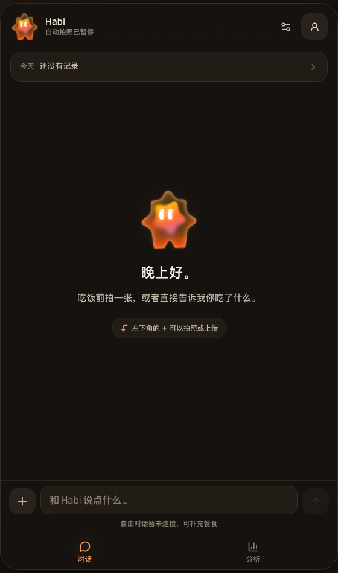
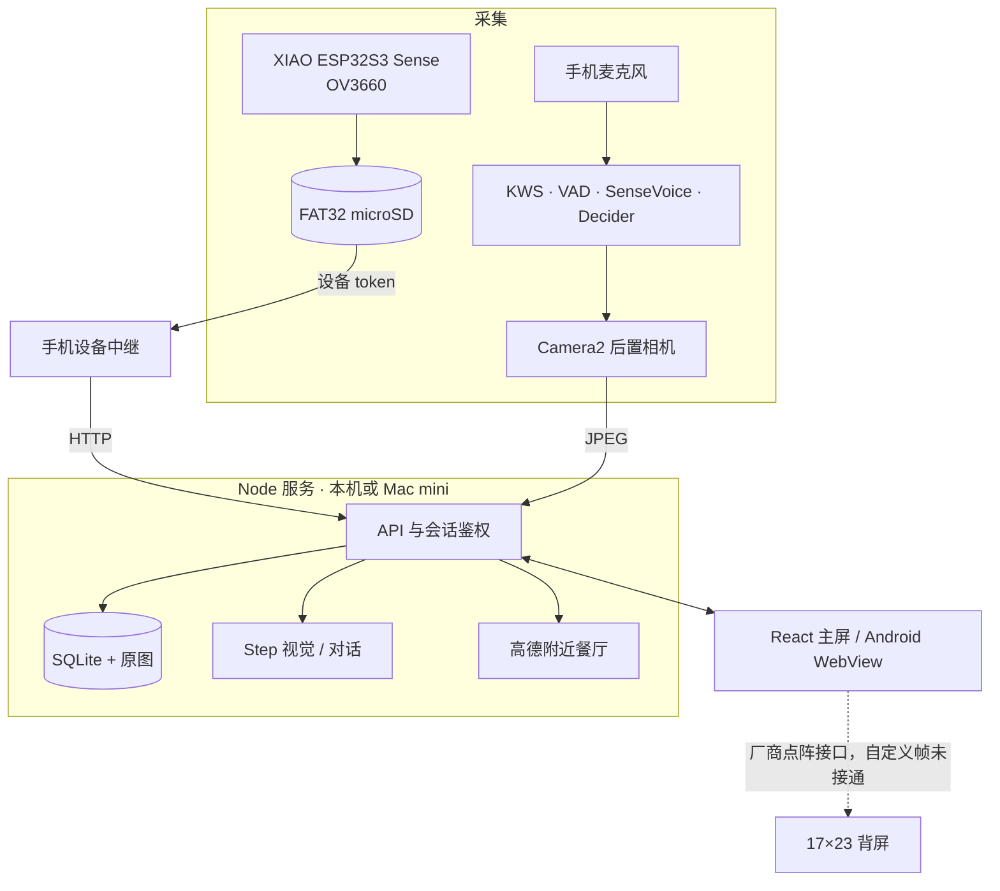

<p align="center"></p>

<h1 align="center">Habi</h1>

<p align="center"><strong>让记录一顿饭，只剩下确认。</strong></p>

<p align="center">随身相机 · 手机主屏 · 背屏 IP · 本地语音</p>

<p align="center">
  <a href="#快速开始">快速开始</a> ·
  <a href="docs/device/PHONE_CAMERA.md">手机语音拍照</a> ·
  <a href="docs/device/PHONE_PIPELINE.md">本地感知链路</a> ·
  <a href="docs/architecture.md">技术与边界</a> ·
  <a href="docs/api.md">API</a> ·
  <a href="LICENSE">MIT License</a>
</p>

Habi（哈比）是一个饮食记录与背屏 IP 原型，面向希望改善饮食、又难以坚持手动记录的成年人：随身相机降低记录负担，手机主屏承接对话、动态和确认，背屏上的小伴用表情和生活状态陪着你。

它不预置餐食、不虚构热量，也不把识别出的菜名当成测得的摄入。照片先成为候选；吃没吃、吃了多少，仍由你确认。

本仓库是黑客松提交用的公开源码快照（私有主线基线 `0bdc53a`），不含个人数据、模型权重、服务凭据、APK 或固件二进制。本快照的源码对应手机 APK `0.6.0` / `versionCode 10`、ESP32 固件 `0.3.2`；网页与后端随提交 `0bdc53a`。下面写的是这份快照里实际有的东西，以及还没做到哪里。

## 一个例子：说一句「哈比记录」

| 这一步 | Habi 做什么 | 真机到哪一步 |
|---|---|---|
| 说出口令 | 本地流式 KWS 等「哈比」，六秒内等「记录」；SenseVoice 复核整句后跳过用餐 Decider | `0.5.0` 已接通；`0.4.0` 的三次真实拍摄用的是旧口令，新口令待同等真机验收 |
| 后置相机 | 预览帧等待曝光，保存一张 JPEG 后立即关闭相机 | 通过；单张 1920×1080 JPEG，约 247–286 KB |
| 照片到达后端 | App 私有目录落盘、上传，后端交给 Step 视觉复核 | 手机、后端、原图三方 SHA256 一致；三次均 `no_food`，未凭空建餐 |
| 看到食物之后 | 只建立候选餐，不按照片数量累计热量 | 接口与页面通过；真实餐食准确率、份量、热量未验收 |
| 你来确认 | 选「一半」、补充说明，保存后出现同餐收据 | 接口通过；真实餐食完整链路待验收 |

图里是空数据库启动的首页：自动拍照默认暂停，也没有预置餐食。

<p align="center"></p>

<p align="center"><sub>本地空数据库启动的首页；真实餐食、照片与个人数据不会进入仓库。</sub></p>

## 快速开始

### 本地网页

需要 Node.js 22.16+。在一个尚不存在的目录开始：

```sh
git clone https://github.com/Jack-Yang-ai/habi-hackathon.git "$HOME/Projects/habi"
cd "$HOME/Projects/habi"
npm install
npm run build
npm start
```

打开 <http://127.0.0.1:8787>。开发时用 `npm run dev`，前端 5173、API 8787。

首次启动没有预置餐食，也没有虚构热量，设备拍摄默认暂停。没有模型凭据时页面显示「未估算」，对话走本地基础规则，不是自由对话模型。

`npm run verify` 会跑语法检查、API 测试和前端构建；本快照的测试以合成图片与响应为主，不代表真实餐食识别率。

### 接入模型

复制 `.env.example` 为 `.env`，填自己的服务地址、密钥与模型名；密钥只留在服务端，不进入前端或 Git。`STEPFUN_API_KEY` 对应阶跃星辰的视觉/对话接口，`AMAP_WEB_SERVICE_KEY` 用于附近餐厅。配置后，手动照片在用户选择分析后才发送；开启「自动拍照与识别」后，设备首图会送 Step 复核。

### 手机端

需要 JDK 17、Android SDK、Gradle，以及一台开启 USB 调试的 Android 手机。模型权重约 740 MB，不在仓库里，由脚本下载并核对哈希：

```sh
python3 tools/decision/prepare-android-local.py --install-toolchain --skip-probe-build
python3 tools/decision/prepare-android-kws.py
python3 tools/device/build-android.py --install
python3 tools/decision/deploy-android-models.py --serial YOUR_ADB_SERIAL
python3 tools/decision/prepare-android-kws.py --deploy --serial YOUR_ADB_SERIAL
```

装好后在手机页面的设备面板点「开启聆听与语音拍照」，允许麦克风、相机和通知。手机页面和 API 目前仍通过 `adb reverse tcp:8787 tcp:8787` 访问电脑服务，**没有实现脱离电脑独立运行**。操作与边界见[手机语音拍照](docs/device/PHONE_CAMERA.md)和[手机本地感知](docs/device/PHONE_PIPELINE.md)。

### 开发板

目标硬件是 XIAO ESP32S3 **Sense**（OV3660 相机、8 MB PSRAM/8 MB Flash），固件在 `firmware/xiao-sense/`。板子默认 `paused`：没有有效采集窗口不会拍。需要 2.4 GHz 网络与 FAT32 microSD。接线、配网、烧录和四层验收见[ESP32 接板联调](docs/device/ESP32_BRINGUP.md)；协议仿真见[ESP32 连接器](docs/device/ESP32_CONNECTOR.md)。

### 线上联调

对外联调以 Mac mini 上的 <https://habi.zhexin.site> 为准（Cloudflare 前置、App 与设备双口令）。一键检查：

```sh
node --env-file-if-exists=.env tools/backend/check-remote.mjs \
  --base https://habi.zhexin.site \
  --app-token "$APP_ACCESS_TOKEN" --device-token "$DEVICE_ACCESS_TOKEN"
```

脚本检查健康、线上前端包版本、App 会话、模型配置、设备鉴权和可选的真实上传→Step 复核。2026-10-17 首次检查记录了两处配置问题（线上版本落后、设备 token 不一致），修复与复验步骤见[线上域名联调](docs/device/REMOTE_INTEGRATION.md)。

## 各端能做什么

### 手机主屏

| 功能 | 可以做什么 | 状态与前提 |
|---|---|---|
| 个人资料 | 昵称、性别、年龄、身高、体重、目标、忌口，全部选填，可再编辑和清空 | 存本地 SQLite；当前不发送给模型 |
| 拍照与上传 | JPEG/PNG/WebP 原图保留；手机后置相机单张拍照 | 页面与真机相机通过 |
| 候选餐 | 同设备同 session 的多张图归到一个候选餐，不按张数累计热量；`capture_id` 幂等 | 接口与页面通过 |
| 食量确认 | 选择吃了多少，支持「一半」和补充说明；保留原估算、食量与更正记录 | 接口通过；真实餐食待验收 |
| 原位表达与对话 | 对话只产生待确认建议；明确确认后原子保存食量、备注并显示同餐收据 | 接口通过；多餐冲突时保留草稿 |
| 小伴动态 | 小屋动态是可明确标记的虚拟 IP 故事；食量、体重和漏记不作为惩罚依据 | 前端演示模式不写真实数据库 |

### 手机语音拍照与本地感知

| 功能 | 可以做什么 | 状态与前提 |
|---|---|---|
| 唤醒口令 | 「哈比」唤醒，六秒内说「记录」；大小写、空格、标点不影响；否定/引用/未来语义不触发 | 真机三段真实语音各拍一张（旧口令）；更多口音与噪声未评 |
| 短句复核 | 实时 KWS 后用 VAD 句尾与 SenseVoice 确认整句，跳过不相关的用餐 Decider | 单条 AudioRecord 同一路音频 |
| 后置相机 | 预览帧等待曝光，保存一张 JPEG 后立即关闭相机；失败最多三次有界补传，不重拍 | 单张 1920×1080；后台需可见页面启动前台服务 |
| 本地模型 | Silero VAD → SenseVoice INT8 → Decider Q4，全部在手机 CPU 上跑；原始音频留在手机 | 常驻约 740 MB；Mac 不参与这三步 |
| 连续录音实测 | 357.28 秒、35 个完整片自动处理，0 处理失败、0 队列溢出 | 短测，不等于 12 小时/锁屏续航 |
| 重连补验 | 累计 1478.34 秒、148 个 WAV；142 片已处理，出现 1 次队列溢出，共 6 片未分析，原音频保留 | 这是失败证据，不表述为全部成功 |

「准备去吃饭」足以请求一张验证图，不要求已经在吃；只有首图确认食物后才建立候选餐。明确语音口令只拍一张，不打开 ESP32 窗口。

### 背屏与小伴

| 功能 | 可以做什么 | 状态与前提 |
|---|---|---|
| 厂商背屏 | 17×23 点阵、单独厂商 manager，不是 Android 常规 secondary display | 已发现并读回尺寸 |
| 系统动画 | 设置 `listening` + wake 后，系统内置动画可点亮 | 用户肉眼确认 |
| 自定义像素帧 | 把 Habi 的 IP 帧写到背屏 | **未上屏、未验收**；厂商权限为 signature/privileged，本机无 root |
| IP 表情与状态 | 主屏上的小伴表情、状态与相处记录 | 网页素材已接入；背屏目标未完成 |

当前这台 PZ261A 的背屏不是一块可以随便画的公开显示屏。代码保留了点阵帧协议与契约（`contracts/rear-display/`），但把网页画稿当成硬件已上屏是不成立的。

### ESP32 随身相机

| 功能 | 可以做什么 | 状态与前提 |
|---|---|---|
| 真机曝光 | 收到窗口后由固件控制 OV3660 拍一张，落 FAT32 microSD | 2026-10-17 首次打通 |
| 上传与入库 | 经手机热点/中继带设备 token 上传，服务端落库并触发 Step 复核 | 通过；首张 `uncertain / foodDetected=false`，未建餐 |
| 窗口策略 | 首图 `probe`，有食物才开 `followup`，最多补 2 张；5 分钟冷却 | 固件协议与 7 组 HTTP 仿真通过 |
| 断网与补传 | SD 队列退避重试，唤醒后补传 | 已观察到 `pending` 归零；佩戴角度、续航、画质未验收 |

固件从 0.3.1 升到 0.3.2，修的正是上传接口里 `metadata` 字段被重复 `JSON.parse` 的兼容问题。板子不存 Step 密钥，视觉复核只在后端。

### 附近餐厅推荐

附近餐厅后端已接入高德 Web 服务：位置上报、按用餐意图/饭点主动生成、换一家、步行导航数据、收起/选择与待投递提醒。Key 只在服务端 `.env` 配置。**本轮没有接前端、Android 定位或系统通知展示**；离线合成接口测试不等于真实高德调用或餐厅健康程度验收。接口见[餐厅接口文档](docs/dining-api.md)。

## 各端怎样协作

下图是当前代码的职责示意，不是公开部署保证：



手机照片与设备照片走不同凭据：手机用 App 会话或 `X-App-Token`，ESP32 用 `X-Device-Token`，两者不能互用。原始音频留在手机，Step 密钥只在后端。

## 数据与边界

| 数据 | 去向 |
|---|---|
| 餐食、照片、个人资料 | 本地 SQLite 与 `.data/`，默认只监听 loopback；通过局域网连接板子时才需设置 `HOST` 与两份口令 |
| 手机录音 | 留在 App 私有目录，不上传；VAD/ASR/Decider 都在手机本地 |
| 拍照请求所需材料 | 原图送到你配置的后端；Step 视觉与对话只拿回答所需内容 |
| 密钥 | `.env`，Git 忽略；仓库只有 `.env.example` 占位符 |
| 演示模式 | 仅保存在前端，不写真实数据库 |

- 本快照不含个人数据库、录音、转写、标签、模型权重、APK、固件二进制或任何服务凭据。
- 模型与云服务可能产生费用，项目没有免费额度承诺。
- 识别食物、估计份量、判断实际摄入是三步，代码不把识别菜名写成测得热量。

## 还没做到哪里

- **背屏自定义帧**：当前只点亮过系统内置厂商动画，Habi 自己的点阵帧尚未上屏。
- **息屏保活**：这台厂商 ROM 在息屏后会冻结 App 并强制禁用 wake lock（`reason=FROZEN`）；加 doze 白名单、后台授权、重启复测都无效。演示期需保持屏幕常亮；换标准 Android 机型是后续验收项。
- **root 与厂商权限**：本机无 `su`，bootloader locked；`MANAGE_BACK_SCREEN` 为 signature/privileged，普通新包拿不到。
- **真实餐食准确率**：现有结论来自合成图、桌面杂物和 `no_food` 结果，不能代表真实餐食的识别率、份量或热量误差。
- **手机脱离电脑**：页面与 API 仍依赖电脑/USB 反向端口；独立常驻服务在 Mac mini 上，但完整离线性未验收。
- **ESP32 长期表现**：画质、佩戴角度、续航、断网恢复与真实食物照片尚未验收。
- **线上部署**：首次检查发现线上版本落后与设备 token 不一致，需按文档修复后复验。
- **Studio 导出**：Studio 生成内容能否导出、导出后能否本地构建分别检查，当前记录在 `docs/studio/`。
- **长时采集**：357 秒与 1478 秒都是短测；12 小时、锁屏和续航未验证。

## 接下来

- 稳定 Mac mini 线上部署，让 `check-remote.mjs` 六项全绿。
- 把 Habi 自定义点阵帧送上背屏并肉眼验收。
- 换一台标准 Android 机型复测息屏保活，或拿到厂商系统级免冻结权限。
- 用真实餐食做小样本评测，分别报告识别、份量和摄入。
- 补齐 ESP32 佩戴、续航、断网与画质验收。
- 让手机在没有电脑和 USB 的情况下跑完整链路。
- 核验 Studio 导出链路，录制一段真实的 90 秒演示。

## 文档与目录

| 想了解 | 入口 |
|---|---|
| 产品约束、分工与验收链路 | [实施边界与分工](docs/architecture.md) |
| API 与事件 | [API](docs/api.md) · [契约](contracts/app.ts) |
| 手机语音拍照 | [手机相机与后台口令](docs/device/PHONE_CAMERA.md) |
| 手机本地感知 | [手机本地感知与 ESP32 首图链路](docs/device/PHONE_PIPELINE.md) |
| ESP32 固件与接板 | [连接器](docs/device/ESP32_CONNECTOR.md) · [接板联调](docs/device/ESP32_BRINGUP.md) |
| 真机验收记录 | [设备验证](docs/device/VALIDATION.md) |
| 背屏与厂商接口 | [自定义背屏](docs/device/CUSTOM_REAR_DISPLAY.md) · [原生背屏](docs/device/NATIVE_REAR_DISPLAY.md) |
| 附近餐厅 | [餐厅接口](docs/dining-api.md) |
| 线上部署与联调 | [Mac mini 后端](docs/device/MAC_MINI_BACKEND.md) · [线上域名联调](docs/device/REMOTE_INTEGRATION.md) |
| 模型选型 | [决策模型](docs/models/decision-options.md) · [Android 本地推理](tools/decision/ANDROID_LOCAL_INFERENCE.md) |
| Studio 生成内容 | [Studio](docs/studio/README.md) · [连接器](docs/studio/CONNECTORS.md) |

| 目录 | 内容 |
|---|---|
| `apps/studio/` | React 主屏、点阵 IP 素材与 Studio 导出页面 |
| `services/api/` | Node API、SQLite、Step 与高德适配、拍照复核 |
| `android/` | 原生宿主、连续录音、相机、KWS 与设备中继 |
| `firmware/xiao-sense/` | XIAO ESP32S3 Sense 固件 |
| `audio/` | 独立声音事件/咀嚼实验，尚未接入当前手机链路 |
| `contracts/` | 前后端与设备契约、背屏帧、KWS 模型锁 |
| `tools/` | 构建、部署、验收与联调脚本 |
| `docs/` | 架构、接口、设备与真机验收记录 |

## 参与和许可

欢迎用不含私人信息的例子提交 Issue 或 PR；涉及真机、模型和线上服务的结论请附可复现的命令与原始回执，不要把合成图测试当成真实餐食验收。

第一方代码采用 [MIT License](LICENSE)；第三方模型、依赖与素材遵循各自许可。本仓库不附带模型权重、个人数据或生产凭据。
