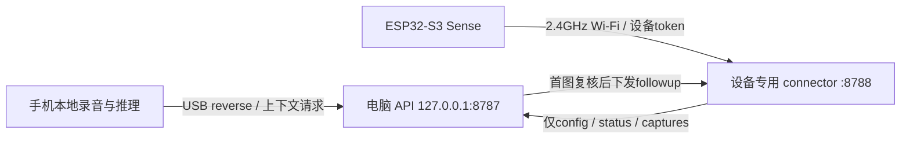

# ESP32 软件连接与验证

本轮用户说明开发板暂不在手边。这里只交付固件、开发配置工具、设备专用中继、真实HTTP协议仿真及明确分开的真实Step测试。这里的验证脚本不启用麦克风、不调用手机相机、不刷写开发板、不把仿真心跳发送到用户的8787服务；手机录音的独立真机验收见[手机链路](PHONE_PIPELINE.md)。

## 目前的数据路径



手机的`adb reverse tcp:8787 tcp:8787`只使手机访问电脑loopback服务；板子不能把自己的127.0.0.1或手机的反向端口当成电脑API。开发板应访问电脑在同一可达网络中的IPv4地址和8788端口。手机热点也可用于联网，但电脑和板子都必须接入，且热点应允许它们相互通信；当前没有验证该路由。

8787继续只监听本机，`tools/esp32/connector.py`另建8788入口，固定转发到loopback API。它只接受：

| 方法 | 路径 | 作用 |
| --- | --- | --- |
| GET | `/api/device/config?device_id=...` | 获取阶段、预算、截止时间、上传开关 |
| POST | `/api/device/status` | JSON设备状态 |
| POST | `/api/device/captures` | multipart图片+metadata，保持原始幂等ID |

每条请求都要求独立强设备token，App状态、暂停、音频、聊天、媒体读取等路径均不开放。连接器不转发客户端Cookie、App token或Step密钥，不跟随重定向，限制JSON/图片请求大小、并发和超时。这里只是受控局域网HTTP开发通路，未实现生产TLS。

## 无板时复现软件验证

依赖现有Node22、Python3、C++11编译器及本仓库API的npm依赖。从仓库根目录运行：

```sh
python3 tools/esp32/connector.py inspect
python3 tools/esp32/test-firmware.py
python3 -m unittest discover -s tools/esp32 -p 'test_*.py' -v
node tools/esp32/http-e2e.mjs
```

inspect只输出串口名称和配置是否存在，不打印Wi-Fi或token。2026-10-15仅发现debug-console/Bluetooth串口，无开发板；本地SSID、密码和设备token均未配置。

HTTP脚本编译**同一个固件CaptureWindowPolicy.h**，通过C++固定命令适配器执行窗口预算，再经Python中继访问真正监听随机loopback端口的API。临时API使用独立目录和鉴权，不读取`.data`或`.env`；结束后移除自己的临时目录及进程。视觉返回由明确标记的确定性夹具提供；图片是1×1合成PNG，不是真实食物。

七组实际通过的协议场景：

| 场景 | 观察到的结果 |
| --- | --- |
| 首图无食物 | 仅1张入库，结束窗口，不创建餐食 |
| 首图有食物 | 新followup ID、同session_id，最多再2张，形成1个候选餐组 |
| 首图不清楚 | 只开放1张重试；第二张仍不清楚就结束 |
| 丢ACK重送 | 重送同capture_id返回200，无新曝光、无重复模型复核 |
| 用户暂停 | 禁止新帧，已排队图仍收到持久ACK；不继续视觉补拍 |
| 离线到期 | 不再轮询也由C++单调期限停止；服务端亦无有效窗口 |
| 重启预算与入口隔离 | 文件模拟NVS不补满已预占的probe；无token401，App路径404 |

报告位于被忽略的`output/validation/esp32-http-e2e.json`，明确`hardware_camera_test=false / microphone_started=false / step_api_called=false / production_8787_contacted=false / lan_listener_opened=false`。NVS为文件模拟，不是ESP flash断电验收；这个脚本也没有执行Arduino网络栈、真实Wi-Fi、摄像头、SD或Step视觉模型。

### 显式调用真实Step的隔离回放

`check-live-first-photo.mjs`要求显式`--live`，会把指定的合成PNG发送到真实Step，产生API用量。它重用本地已有手机回执中的原始模型结果与采集时间，仅把临时服务器时钟回到该时刻并按真实经过时间推进；不重新录音、不伪造新的采集时间。保存的报告缺少完整recentUtterances时，回放使用空历史并明确标注，不能冒充原始请求逐字节重放。

```sh
node --env-file-if-exists=.env tools/esp32/check-live-first-photo.mjs --live --phone-report output/validation/phone-preparation-retest.json --no-food-png output/validation/step-interface-check.png --output output/validation/phone-connector-step-replay-02.json
```

需要先在本机生成对应回执和测试PNG；它们不随源码提供。脚本使用随机loopback端口、临时数据库与一次性鉴权；连接器进程只收到临时设备token，Step key仅留在模型调用进程。结束后清理自己的进程和临时目录，报告保留在被Git忽略的output中。

2026-10-15真实运行两次：第一次首图复核failed、原照片持久化且没有继续拍摄，底层失败原因未捕获；第二次Step HTTP200，明确无食物，结束窗口、0餐食，重复上传200且总计只调用一次视觉。通过报告是`phone-connector-step-replay-02.json`，首次失败另保留在`phone-connector-step-replay.json`。这项未执行C++固件策略和实际曝光；上述七组离线仿真则未调用Step，两类证据不可合并为一次ESP实拍通过。

## 后续接板时配置

板子已到货，按[ESP32接板联调](ESP32_BRINGUP.md)的分层步骤执行；下面是无板阶段的原始配置说明。

先生成本地随机设备token（已有文件时跳过，不静默轮换）：

```sh
python3 tools/esp32/connector.py init-token
```

默认写`.tools/esp32/device-token`，权限0600，不显示值。Wi-Fi名和密码可通过本机终端隐藏输入；API地址示例192.168.50.2须换成电脑实际局域网地址，可用`ipconfig getifaddr en0`查询：

```sh
python3 tools/esp32/connector.py prepare --interactive --api-base http://192.168.50.2:8788 --replace
```

这只更新被忽略的`firmware/xiao-sense/include/secrets.h`，权限0600，不编译、不刷写、不写其他App配置。自动化也可通过`ECHO_WIFI_SSID/ECHO_WIFI_PASSWORD`环境变量提供，勿把密码放命令参数或提交源码。

默认中继仍只监听loopback：

```sh
python3 tools/esp32/connector.py serve --token-file .tools/esp32/device-token
```

板实际在同网后，显式启用LAN监听的命令是：

```sh
python3 tools/esp32/connector.py serve --host 0.0.0.0 --port 8788 --upstream http://127.0.0.1:8787 --token-file .tools/esp32/device-token
```

如果8787本身设置了DEVICE_ACCESS_TOKEN，连接器进程也需安全注入同一环境变量，或用`--upstream-token-file`提供单独0600文件。板端只持有connector设备token，不能放STEPFUN_API_KEY。结束中继用当前终端Ctrl-C；它不启动、停止或重启8787。

随后才按[固件构建说明](../../firmware/xiao-sense/README.md)确认新串口、Sense相机与SD并上传。需要的实物条件是USB数据线、2.4GHz网络、带相机的Sense扩展、FAT32 microSD及正确供电/天线；本轮用户不必提供网络密码。

## 固件可靠性修正

- 窗口/餐组ID与API一致，只允许`[A-Za-z0-9_.:-]`，最多128字符。probe上限1、followup上限2，同ID不能换身份或补预算。
- 锁定驱动头文件明确说明WHEN_EMPTY可能返回旧缓冲。0.3.1有界丢弃触发前的帧，只保存驱动boot时间不早于请求且窗口未过期的JPEG；失败不保存旧图，不退预算自行重拍。新增request/frame uptime和frame_age诊断。
- 有PSRAM时先分配UXGA JPEG缓冲，供OV5640 AF短暂使用SXGA，再恢复SVGA输出；没有足够PSRAM时跳过AF并报告原因，避免用小缓冲接更大画面。
- Serial仅在Wi-Fi状态变化时报告状态/IP/RSSI，不打印SSID、密码或token。元数据容量不足时不生成残缺队列项。
- 上传ACK按JSON过滤器只读取精确capture_id，避免返回的餐组信息超过原2048B解析arena而反复重传。相同解析器对50KB合成附加餐组字段、128字符ID、错误/缺失ID及畸形JSON的主机验证已通过。

这些相机路径已编译，尚未实机验证帧新鲜度、镜头焦点、摄像头超时、功耗或SD断电恢复。官方依据：[Seeed入门与2.4GHz/引脚](https://wiki.seeedstudio.com/xiao_esp32s3_getting_started/)、[Seeed相机与AF示例](https://wiki.seeedstudio.com/xiao_esp32s3_camera_usage/)、[Espressif帧缓冲/时间戳定义](https://github.com/espressif/esp32-camera/blob/master/driver/include/esp_camera.h)；本次同时核过实际锁定Arduino2.0.17 SDK内的esp_camera.h。

## Step Studio连接器边界

Studio源码核查见[CONNECTORS.md](../studio/CONNECTORS.md)。该导出版本未登记连接器，chooseImage是手机媒体能力；壳request仅HTTPS，不能直接替代当前HTTP设备通道。本机设备connector是本项目实现，不标成Step Studio官方连接器，也没有靠更换URL字符串伪装TLS。后续如取得官方连接器名称、版本和真实硬件协议，可在这里的窗口/ACK契约外增加适配层。
